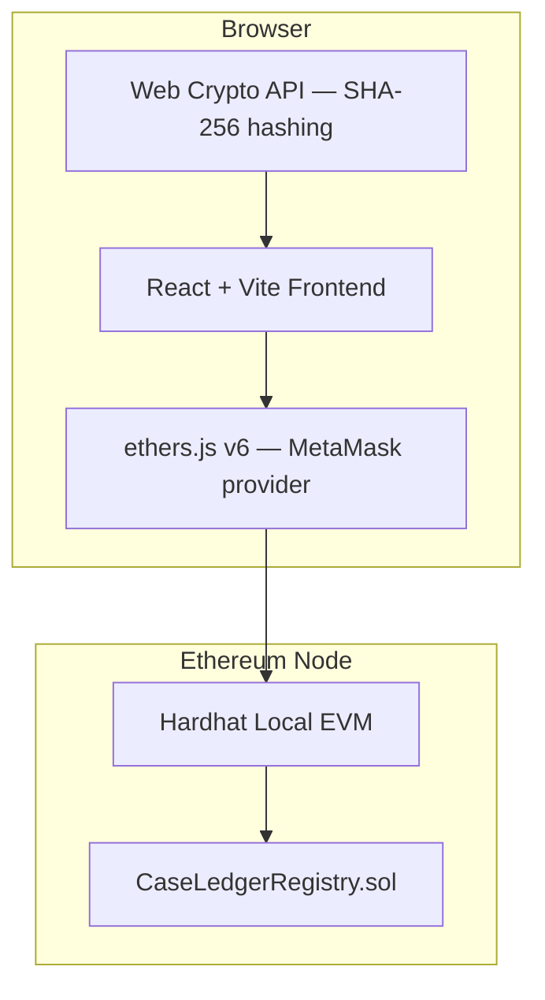
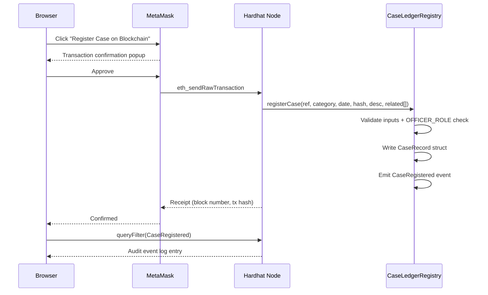

# CaseLedger

**Blockchain-Based Criminal Case Record Management and Audit System**

> Academic Mini-Project — Introduction to Blockchain Technology (IBCT)

---

⚠️ **IMPORTANT DISCLAIMER**

This system is an **academic prototype only**. It is **not** suitable for storing, processing, or managing real criminal records, personally identifiable information, or any data subject to data-protection or criminal-justice law.

All case references, identities, and records used in this demonstration are **entirely fictional**. No real persons, real cases, or real criminal histories are involved.

Blockchain status values represent **administrative case progress only** and do not constitute a finding of guilt, a conviction, or any legal determination of any kind. A complaint, an investigation, a charge, and a conviction are entirely different things — this system does not conflate them.

---

## Project Overview

CaseLedger is a decentralized application (dApp) that demonstrates how blockchain technology can support tamper-evident audit trails, role-based authorization, verifiable record integrity, and controlled case-status transitions in a case-management context.

Authorized case officers register fictional case records with cryptographic metadata commitments. Reviewers submit on-chain review events and progress updates. Anyone can verify whether a case document is consistent with its registered commitment. All operations are anchored on an Ethereum-compatible blockchain, providing an immutable audit history.

---

## Problem Statement

Traditional case-management systems face several challenges:

- Records can be silently modified without a traceable audit trail
- Authorization for sensitive operations is managed by a central authority that may be compromised
- There is no independently verifiable proof that a record has not changed since it was filed
- Downstream impact of a compromised record is difficult to trace

This prototype demonstrates how blockchain can address these concerns through immutability, smart-contract-enforced access control, and cryptographic integrity commitments — while keeping sensitive data off-chain.

---

## Objectives

1. Demonstrate role-based access control enforced entirely in Solidity
2. Store cryptographic metadata commitments on-chain without storing sensitive case details
3. Provide independently verifiable record integrity checking
4. Maintain an immutable, chronological on-chain audit trail of all case events
5. Support controlled case-status state transitions with documented progression rules

---

## System Architecture



---

## Role and Permission Model

| Role | Contract Constant | Capabilities |
|---|---|---|
| Administrator | `DEFAULT_ADMIN_ROLE` (0x00…00) | Grant/revoke OFFICER and REVIEWER roles. Deployer receives this automatically. |
| Case Officer | `OFFICER_ROLE` | File case records, update metadata commitments, advance case status. |
| Reviewer | `REVIEWER_ROLE` | Record formal reviews, report and acknowledge case updates, advance case status. |
| Public | (no role) | Browse public case information, run integrity verification, read audit trail. |

All permission checks are enforced in Solidity. Frontend role checks are UI-only conveniences and do not replace contract enforcement.

---

## Smart Contract Design

**Contract:** `CaseLedgerRegistry` (Solidity 0.8.24, inherits OpenZeppelin `AccessControl`)

### Case status state machine

```
Registered → UnderInvestigation → ChargesFiled → InCourt → Closed → Archived
                                                         ↗
Closed → UnderInvestigation  (reopen)
Archived  (terminal — no further transitions)
```

These statuses represent **administrative procedural progress only**, not guilt or conviction.

### On-chain data model

| Field | Type | Purpose |
|---|---|---|
| `caseId` | `bytes32` | `keccak256(caseRef + "@" + filingDate)` — deterministic unique key |
| `caseRef` | `string` | Fictional reference, e.g. `CASE-DEMO-001` |
| `category` | `string` | Case category label |
| `filingDate` | `string` | ISO date string |
| `metadataHash` | `bytes32` | SHA-256 commitment of off-chain case document |
| `filedBy` | `address` | Officer wallet |
| `registeredAt` | `uint256` | `block.timestamp` |
| `blockNumber` | `uint256` | `block.number` |
| `status` | `CaseStatus` | Current administrative status |
| `relatedCases` | `bytes32[]` | IDs of related case records |

### Key design decisions

- **Deterministic case ID** — `keccak256(caseRef + "@" + filingDate)` prevents duplicates and is computable client-side
- **Metadata commitment** — Only the SHA-256 hash is stored; the actual document stays off-chain
- **State machine validation** — Invalid transitions are rejected by the contract; Archived is terminal
- **Custom errors** — Gas-efficient custom error types throughout
- **No erasure** — No function deletes historical events or overwrites the audit log

---

## Privacy and Data Storage Model

**What is stored on-chain:**
- Opaque case identifiers (synthetic references only)
- SHA-256 metadata commitments
- Administrative status values
- Role assignments
- Audit events (block number, actor, event type)

**What must remain off-chain:**
- Actual case documents and detailed descriptions
- Real names, addresses, government IDs, biometrics
- Detailed allegations or evidence
- Sensitive personal information of any kind

A public blockchain is not appropriate for confidential criminal-record data. In a production system this would require a legally reviewed access-control architecture, encrypted off-chain storage, data-retention policies, correction mechanisms, and appropriate governance. This prototype does not implement any of those features.

---

## Technology Stack

| Layer | Technology |
|---|---|
| Frontend | React 19, TypeScript 5.8, Vite 6, Tailwind CSS 3.4 |
| Icons | Lucide React |
| Web3 | ethers.js v6, MetaMask |
| Routing | react-router-dom v7 |
| Smart contracts | Solidity 0.8.24, OpenZeppelin Contracts 5 |
| Dev toolchain | Hardhat 2.22, hardhat-toolbox 5 |
| Testing | Mocha + Chai + hardhat-network-helpers |
| Hashing | Web Crypto API (browser-native SHA-256) |

---

## Folder Structure

```
IBCT/
├── contracts/
│   ├── CaseLedgerRegistry.sol        ← Core smart contract
│   └── PatchLedgerRegistry.sol       ← Previous project (retained for reference)
├── scripts/
│   ├── deploy.ts                     ← Deploy and export ABI + address
│   └── seed.ts                       ← Seed fictional demo cases
├── test/
│   └── CaseLedgerRegistry.test.ts    ← 55 automated contract tests
├── artifacts/                        ← Hardhat compile output
├── typechain-types/                  ← Auto-generated TypeScript bindings
├── hardhat.config.ts
├── package.json
├── README.md
└── frontend/
    ├── package.json
    ├── vite.config.ts
    ├── tailwind.config.js
    └── src/
        ├── App.tsx                   ← Routes
        ├── main.tsx                  ← Entry point
        ├── index.css                 ← Tailwind + component classes
        ├── types/index.ts            ← All shared TypeScript types
        ├── contexts/
        │   └── Web3Context.tsx       ← MetaMask + contract provider
        ├── hooks/
        │   ├── useContract.ts        ← All contract method wrappers
        │   └── useFileHash.ts        ← Web Crypto SHA-256
        ├── components/
        │   ├── layout/               ← Header, Sidebar, Layout
        │   └── ui/                   ← CaseStatusBadge, PriorityBadge,
        │                                ReviewCategoryBadge, StatCard,
        │                                TransactionModal, ActionModal, etc.
        ├── pages/
        │   ├── Dashboard.tsx         ← Overview stats + active cases
        │   ├── CaseList.tsx          ← Searchable, filterable registry
        │   ├── CaseDetail.tsx        ← Full case record + actions
        │   ├── FileCase.tsx          ← Register new case (OFFICER)
        │   ├── VerifyRecord.tsx      ← Integrity verification
        │   ├── CaseUpdates.tsx       ← Procedural update feed
        │   ├── AuditTrail.tsx        ← On-chain event timeline
        │   └── AdminPanel.tsx        ← Role management (ADMIN)
        └── contracts/
            ├── config.ts             ← Address + ABI import
            └── CaseLedgerRegistry.json ← Updated by deploy script
```

---

## Prerequisites

- [Node.js](https://nodejs.org/) v18 or later
- [MetaMask](https://metamask.io/) browser extension

---

## Installation

```bash
# Root workspace (Hardhat)
cd d:\Daksh\Desktop\My_Project\IBCT
npm install

# Frontend
cd frontend
npm install
```

---

## Local Blockchain Startup

Open a dedicated terminal and keep it running:

```bash
cd d:\Daksh\Desktop\My_Project\IBCT
npm run node
```

This starts Hardhat EVM at `http://127.0.0.1:8545` (Chain ID: 31337) and prints 20 test accounts with private keys.

---

## Contract Deployment

```bash
cd d:\Daksh\Desktop\My_Project\IBCT
npm run deploy
```

This deploys `CaseLedgerRegistry` and writes `frontend/src/contracts/CaseLedgerRegistry.json` with the live address and ABI.

**Re-run after every Hardhat node restart** — the node resets all state when stopped.

---

## Seed Demo Data

```bash
npm run deploy:seed
```

Registers four fictional cases with meaningful status progressions and grants demo roles:

| Case Reference | Category | Status | Notes |
|---|---|---|---|
| CASE-DEMO-001 | Fraud | Registered | Has integrity review + related to CASE-DEMO-002 |
| CASE-DEMO-002 | Theft | Under Investigation | Has priority-3 update |
| CASE-DEMO-003 | Assault | Charges Filed | Full progression demonstrated |
| CASE-DEMO-004 | Cybercrime | Closed | Complete lifecycle demonstrated |

Demo role assignments:
- Account #0 → Administrator + Officer (deployer)
- Account #1 → Officer
- Account #2 → Officer
- Account #3 → Reviewer

---

## MetaMask Setup

1. Open MetaMask → Networks → Add network manually:
   - Network name: `Hardhat Local`
   - RPC URL: `http://127.0.0.1:8545`
   - Chain ID: `31337`
   - Symbol: `ETH`

2. Import demo accounts using private keys printed by `npm run node`:
   - Account #0 private key: `0xac0974bec39a17e36ba4a6b4d238ff944bacb478cbed5efcae784d7bf4f2ff80`
   - Account #3 private key: `0x7c852118294e51e653712a81e05800f419141751be58f605c371e15141b007a6`

3. Switch MetaMask to **Hardhat Local** network.

---

## Frontend Startup

```bash
cd d:\Daksh\Desktop\My_Project\IBCT\frontend
npm run dev
```

Open `http://localhost:5173`.

---

## Testing

### Contract tests (automated — 55 tests)

```bash
cd d:\Daksh\Desktop\My_Project\IBCT
npm test
```

**Result: 55 passing**

Coverage includes:
- Deployment and role setup
- Case registration (valid + all validation failures)
- Metadata update (authorized + unauthorized)
- Status transitions (all valid paths, all invalid rejections, terminal Archived)
- Case reviews (authorized, unauthorized, empty notes)
- Case updates (report, acknowledge, priority validation, double-ack, not-found)
- Integrity commitment (hash match, mismatch detection, post-update)
- Role management (grant, revoke, non-admin rejection)
- View functions (getAllCaseIds, getCaseCount, unknown ID reverts, event history preservation)

### TypeScript type check

```bash
cd frontend
npx tsc -b --noEmit
```

### Lint

```bash
cd frontend
npm run lint
```

### Production build

```bash
cd frontend
npm run build
```

---

## Demo Walkthrough

1. Start node: `npm run node`
2. Deploy + seed: `npm run deploy` then `npm run deploy:seed`
3. Start frontend: `cd frontend && npm run dev`
4. Open `http://localhost:5173`
5. Connect MetaMask with Account #0 (Admin/Officer)

**Key demonstrations:**

| Step | What to show |
|---|---|
| Dashboard | 4 demo cases, status distribution, live audit stream |
| Case Registry | Filter by status (Under Investigation, Charges Filed, Closed) |
| Case Detail (CASE-DEMO-002) | Priority-3 update, related case link, quick integrity check |
| File New Case | Hash a file in browser, submit via MetaMask |
| Verify Record | Upload same file → match; upload different file → mismatch |
| Case Updates | Pending update on CASE-DEMO-002, acknowledge it |
| Audit Trail | Block numbers + tx hashes for all events |
| Admin Panel | Grant Reviewer role to Account #3, query roles |
| Unauthorized operation | Switch to Account #3, try to File a case → rejected |

---

## Transaction Flow



---

## Why Blockchain?

| Property | How CaseLedger Uses It |
|---|---|
| Immutability | Case records and audit events cannot be silently deleted |
| Transparency | Any authorized party can independently verify a record's hash |
| Decentralized authorization | Role permissions enforced in smart-contract code, not a central database |
| Cryptographic integrity | SHA-256 commitment proves whether a document has changed |
| Auditability | Every status change, review, and update is an on-chain event |

**What blockchain cannot guarantee:** The factual accuracy of case information filed by authorized officers. Verification that a hash matches does not establish the truth of the document's content. A blockchain does not independently investigate allegations.

---

## Security Limitations

- This is an academic prototype — not a production security system
- No encryption of off-chain case documents is implemented
- No data-retention or right-to-erasure mechanism exists (blockchain records are permanent)
- Shallow cycle detection only in related-case references
- No multi-signature governance for sensitive role changes
- No audit of who the Hardhat private keys are shared with in a demo environment

---

## Known Limitations

- Local Hardhat network only — no testnet deployment
- No pagination for large case sets
- No off-chain encrypted storage integration
- No correction or expungement mechanism (would require a separate governance layer)
- Case documents stored locally as demo fixtures, not in a real secure store

---

## Future Enhancements

- Deploy to a public testnet (Sepolia) with environment-variable configuration
- Integrate encrypted off-chain storage (e.g. a private IPFS gateway with access control)
- Add multi-signature governance for critical role assignments
- Implement a formal correction/dispute workflow with reviewer quorum
- Add pagination and server-side indexing via The Graph
- Support organizational namespaces and department-level role hierarchies

---

## Work Division (Four Members)

| Member | Contributions |
|---|---|
| Member 1 | Smart contract design, Solidity implementation, access control model, state machine |
| Member 2 | Contract test suite (55 tests), deploy/seed scripts, demo data |
| Member 3 | Web3Context, MetaMask integration, useContract hook, transaction lifecycle |
| Member 4 | Frontend pages, UI components, Tailwind design system, routing |

---

## License

MIT — Academic use only. Not for production deployment with real criminal-record data.
